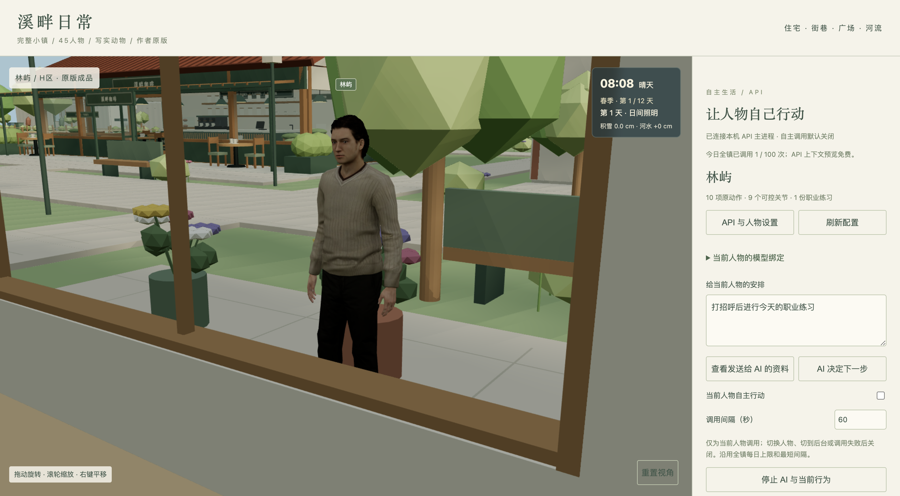

# 溪畔日常 · Pixel Town 3D

一个持续制作中的 AI 小镇：九区场景、人物与动物、四季昼夜天气、角色背景和关系、API 接入与三维行为。当前应用版本 **0.9.0**，本仓库按制作类别整理源码、过程与成品。



| 内容 | 入口 |
|---|---|
| Mac 应用、Windows 便携版、完整当前源码 | [0.9.0 发布](https://github.com/sufencyshao/pixel-town-3d/releases/tag/v0.9.0) |
| 建筑、整镇与模型预览 | [作品预览](docs/作品预览.md) |
| 所有产品与工程按类别下载 | [成品下载](docs/成品下载.md) |
| 规划、九区、环境、美术、AI、打包过程 | [制作过程索引](docs/制作过程索引.md) |
| 当前状态、历史决策和待办 | [项目交接索引](PROJECT_CONTEXT.md) |
| 文件体积、SHA-256、下载地址 | [机器可读目录](catalog/products.json) |
| 第三方模型署名与许可 | [THIRD_PARTY.md](THIRD_PARTY.md) |

## 继续开发

成品应用直接从发布页下载。Windows ZIP 必须完整解压后运行 `PixelTown3D.exe`；Mac DMG 为 Apple Silicon 版本，尚未 Apple 公证。Windows 包尚待实机验证。完整源码 ZIP 已包含运行和重建所需素材，可直接按其中说明开发。

Git 克隆用于日常修改，较大的三维原件和测试原图通过一条命令从同版本完整源码包恢复。需要 Node.js 22 或更新 LTS、Python 3 和已登录的 GitHub CLI（私有仓库下载需要当前账号权限）：

```sh
git clone https://github.com/sufencyshao/pixel-town-3d.git
cd pixel-town-3d
python3 tools/restore-assets.py
cd pixel-town-app
npm ci
npm run start:3d
```

Windows 可将 `python3` 改为 `py`。已下载完整源码包时执行 `py tools/restore-assets.py --archive "完整源码工程.zip的实际路径"`，可跳过网络下载。恢复只补缺少的资源，拒绝覆盖已修改文件，并逐个核对摘要。

```sh
npm run build:3d
npm test
npm run package:3d -- --platform win32 --out releases/local-win
```

Mac 打包将平台改为 `darwin`。付费 API 测试默认关闭，正常逻辑测试使用模拟调用。跨系统须重新填写 API Key，不复制 Mac 钥匙串加密密钥文件。

## 当前范围

45 人物和 16 动物进入整镇；人物采用现成原版，动物采用现有写实成品，保留各自许可。AI 接入真实角色背景、职业与关系，能够执行现有动作、有限上身骨骼姿态、公共步道移动、近距离交流及室外职业练习。仍缺部分动物成品与动作、室内楼层寻路、工具抓握、制造交易及完整物理系统，详见 [V9 说明](pixel-town-app/design/town-ai-v9/README.md)。

Mac 0.9.0 已做独立目录启动与重启验收；Windows 为已完成静态检查的便携包。详见 [打包验收](pixel-town-app/build/validation/release-3d-v0.9.0/验收报告.md)。

## 目录

```text
pixel-town-app/       应用源码、构建脚本、运行素材、各版本设计源代码和说明
pixel_town_assets/    二维人物/宠物公开设定、制作脚本和记录；原图在档案包
docs/                分类入口、制作计划、归档规则
catalog/             产品与资源恢复清单（大小 / SHA-256 / 下载地址）
previews/            当前成品预览
tools/               跨平台资源恢复工具
Releases             应用包、模型/Blender 工程、完整离线预览、历史产品
```

本仓库默认私有，未上传 API 密钥、私人存档、私人日志或完整聊天。历史报告只代表对应版本当时的检查结果。历史美术探索已单独标注，不代表当前认可方案。详细归档范围见[归档说明](docs/归档说明.md)。
