# 作品预览

原制作文件的预览图，未重新绘制。区块为静态设计过程，现成模型选型与人物/动物入镇以 V8/V9 为当前基础。各版本的能力和未完成项见对应说明。

[分类下载](成品下载.md) · [制作过程索引](制作过程索引.md)

## 总体规划

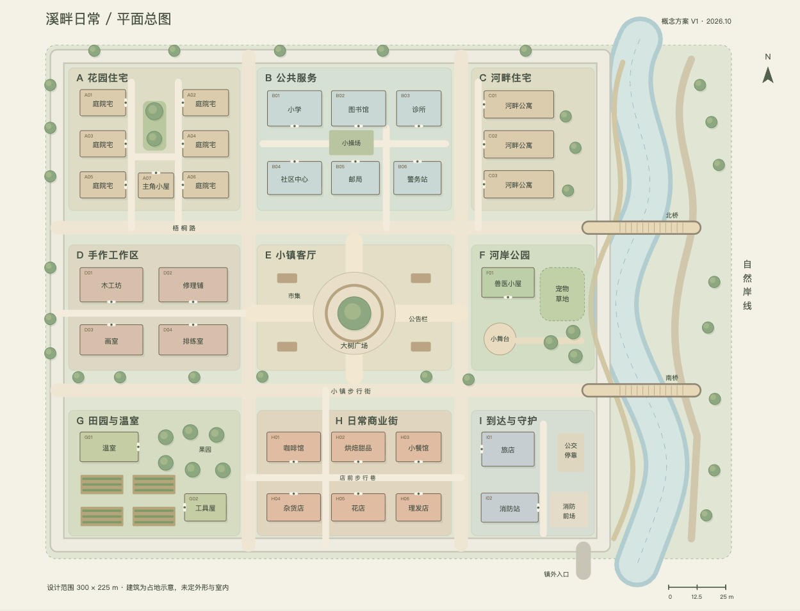

## B 区公共服务

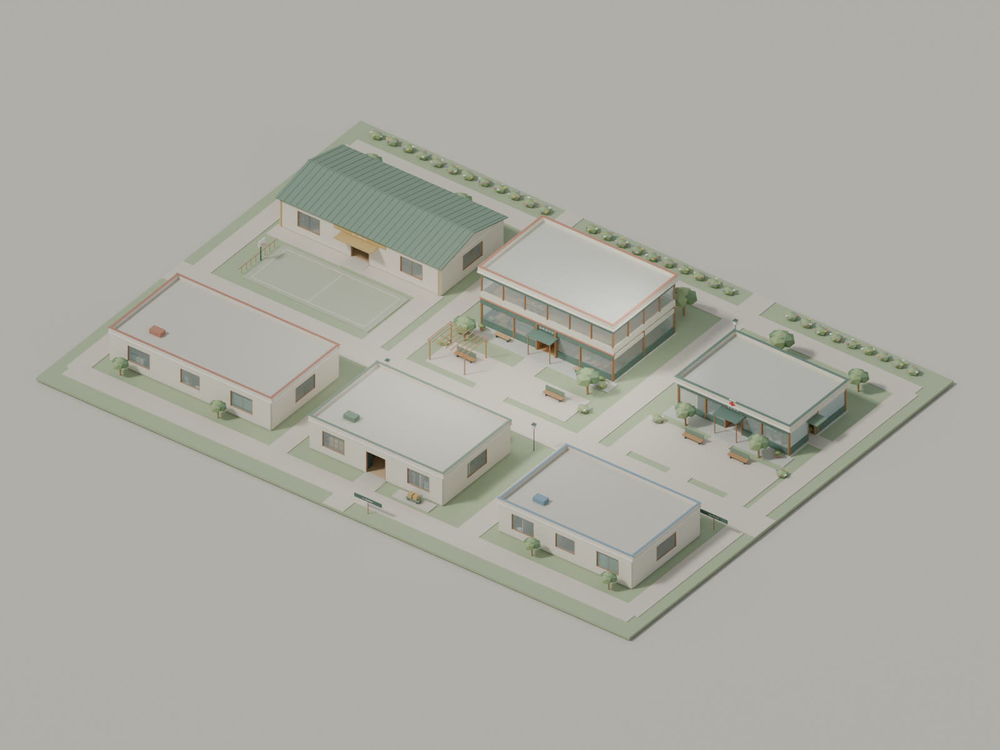

## D 区手作工作区

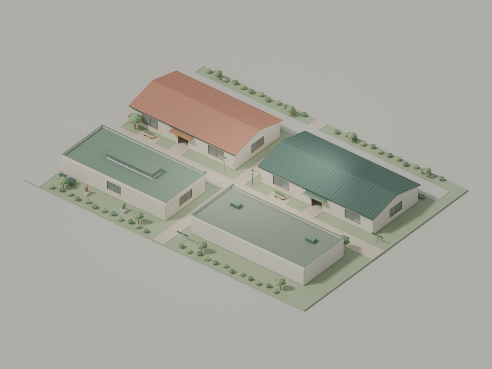

## E 区小镇客厅

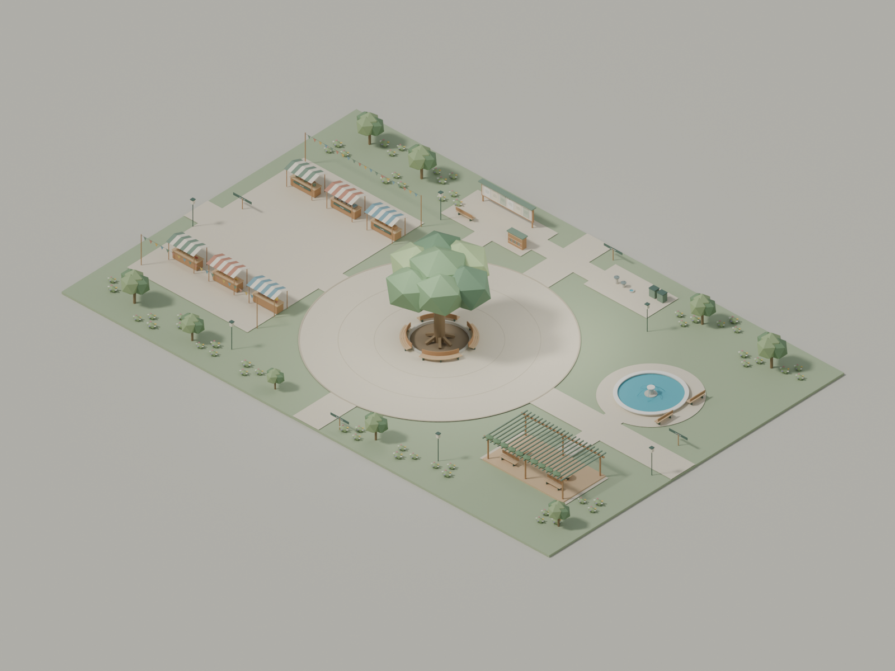

## F 区河岸公园

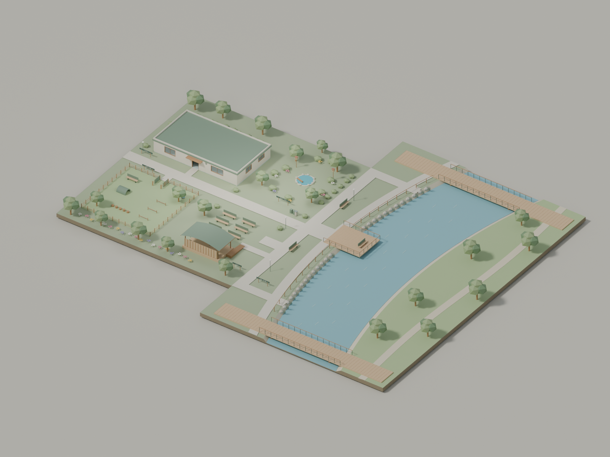

## G 区田园与温室

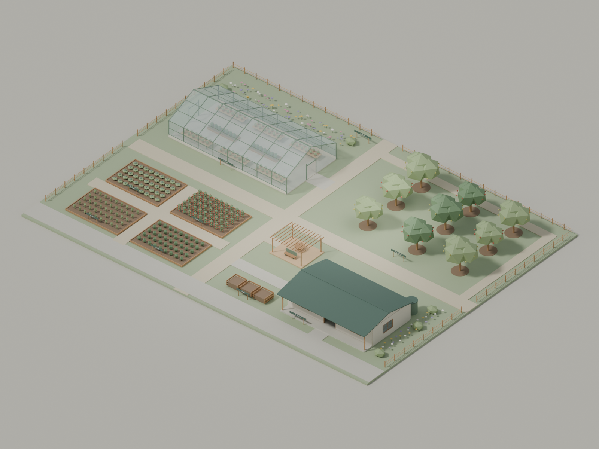

## H 区日常商业街

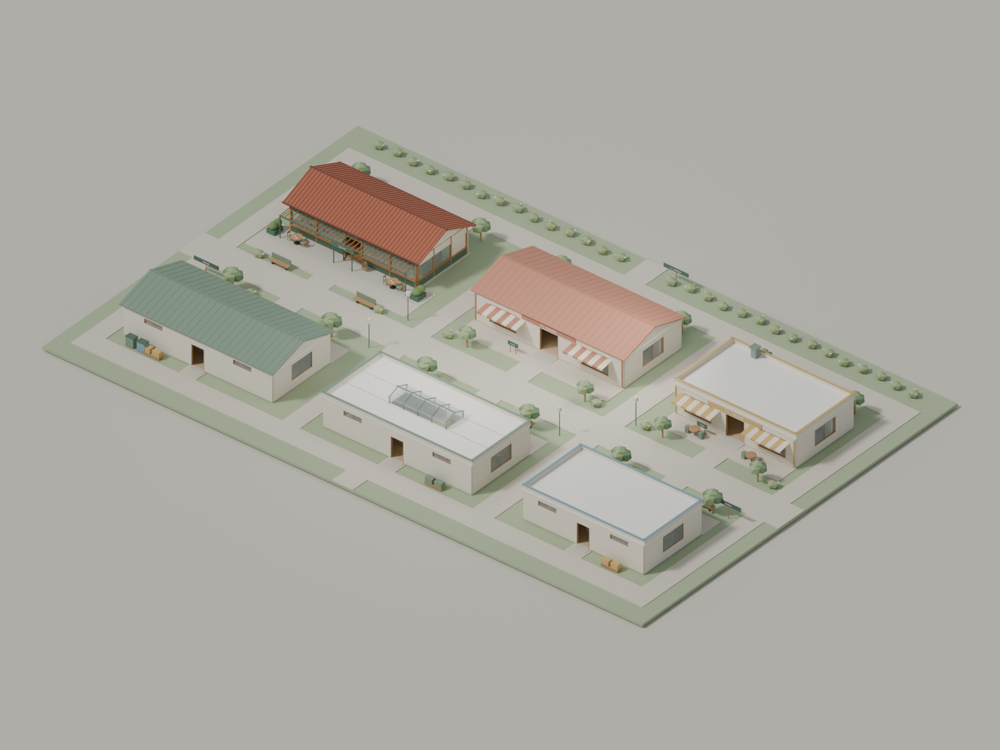

## I 区到达与守护

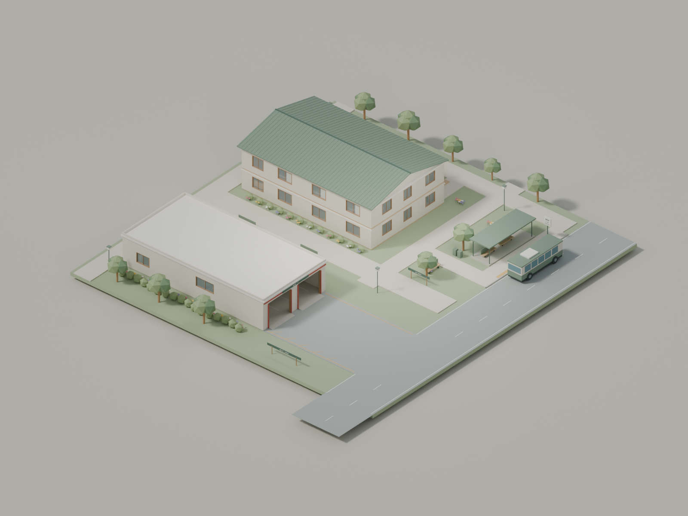

## V8 人物与动物整镇布置

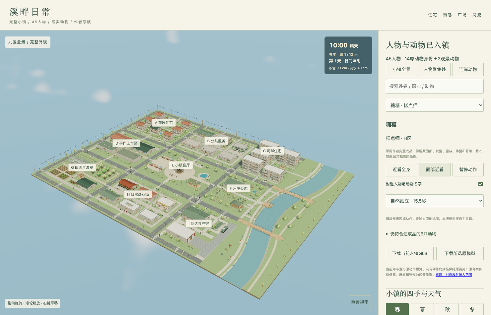

## 写实猫原件

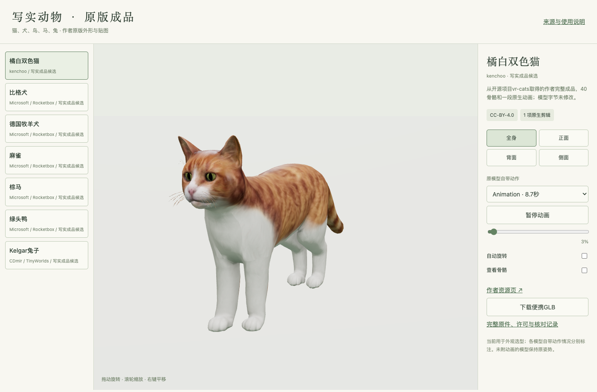

## 写实犬原件

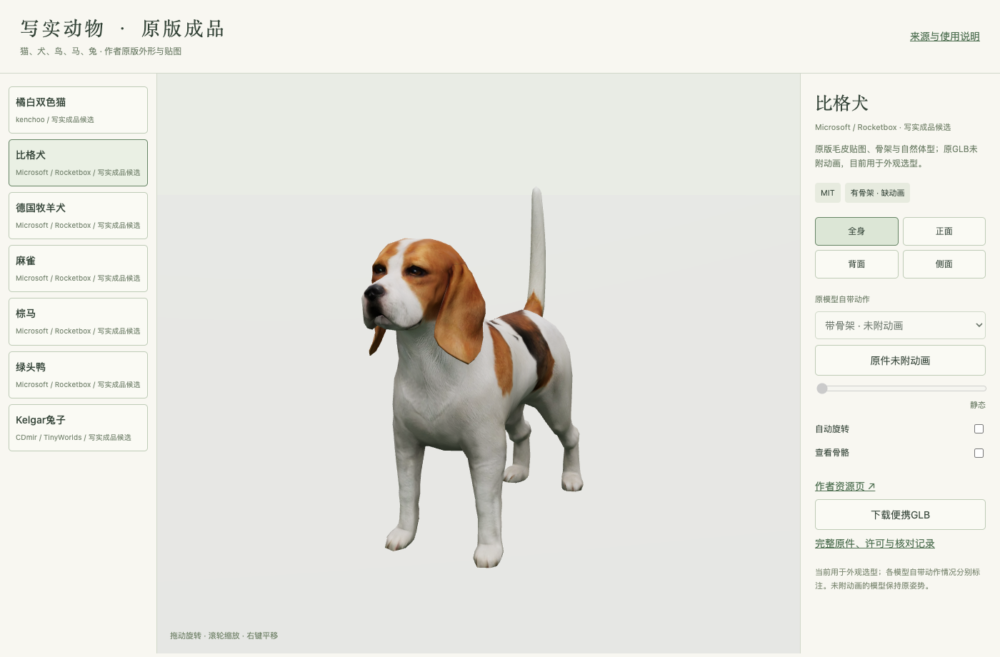

## 写实兔原件

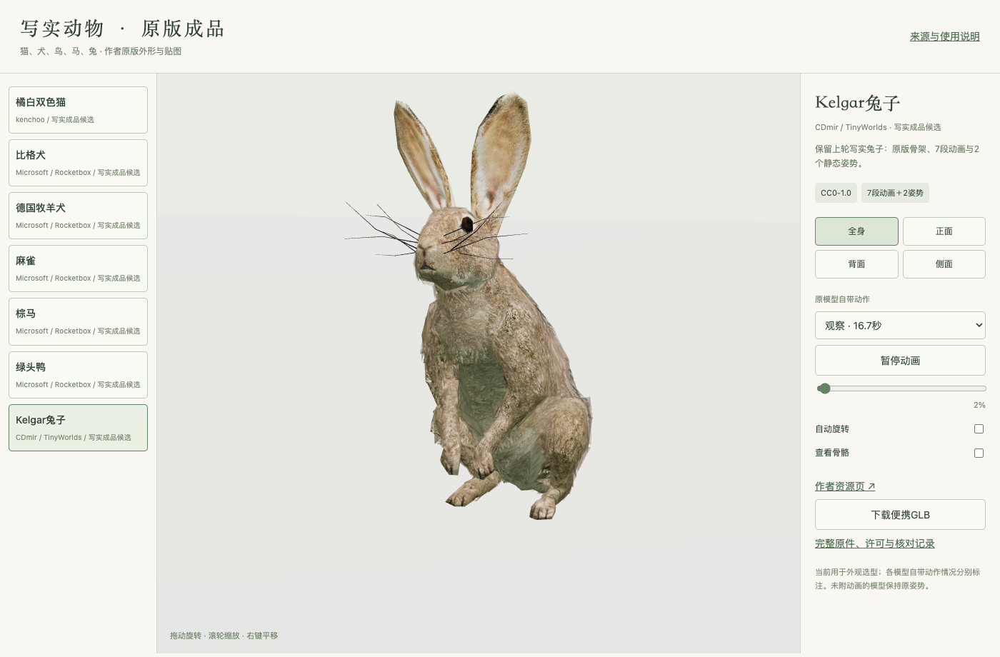

## A 区住宅

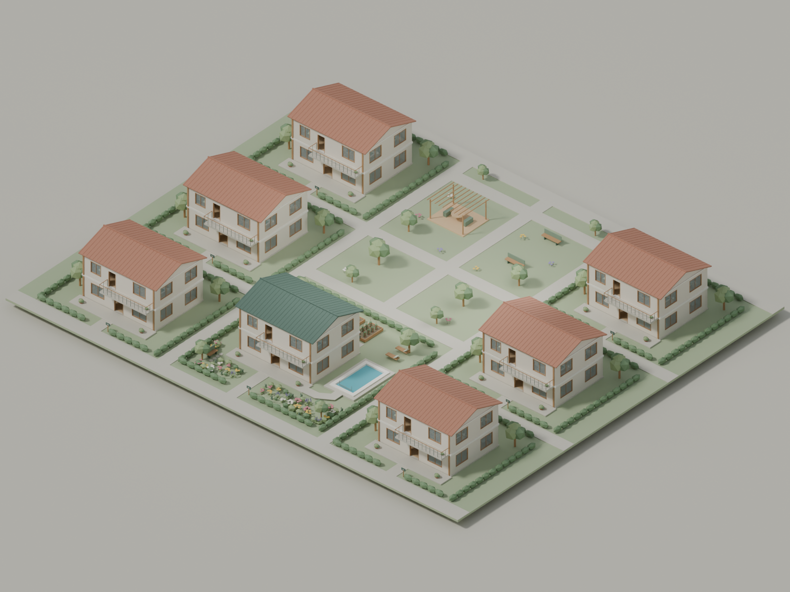

## C 区住宅

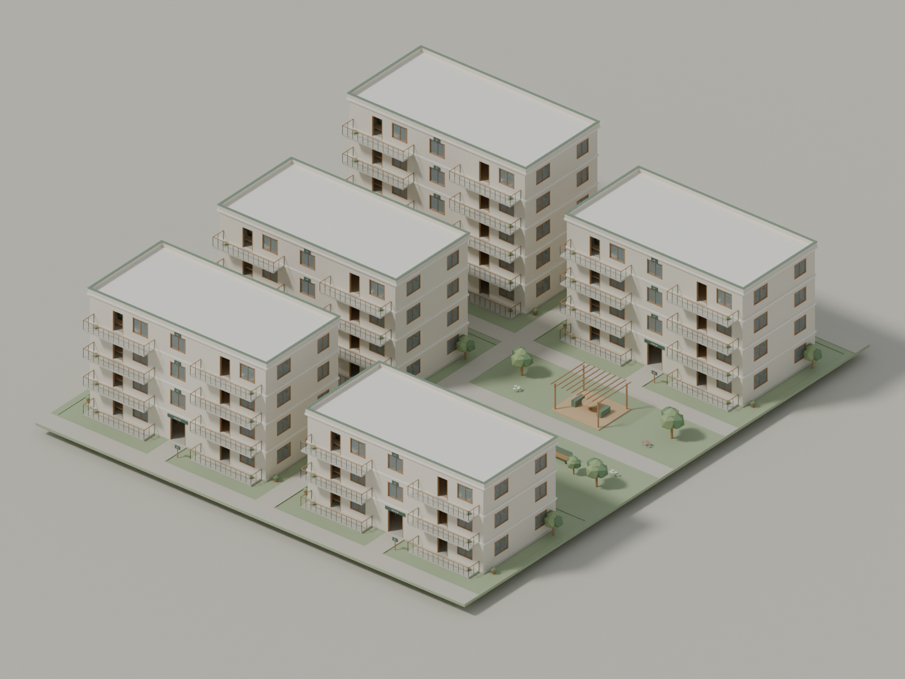

