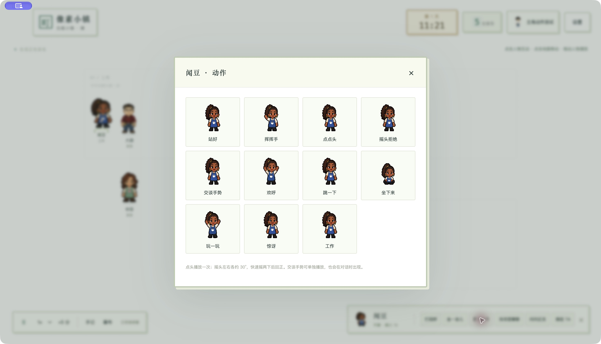

# 人物动作安装记录 · v0.4.0

已安装：[像素小镇.app](/Applications/像素小镇.app)。点击人物 → **更多动作**；预设主角 → **动作与表情**。40 人各 14 组动作，新日常动作共 120 组；全库 65 个对象 / 920 组图集。

## 实际行为

- 点头：16 帧 × 90 ms，单次 1440 ms 后待机。
- 摇头拒绝：25 帧，24 × 30 ms + 480 ms；约 ±30°，720 ms 快速往返两次，480 ms 回正后待机。重复点击从第 0 帧重播。
- 交谈手势：16 帧 × 90 ms，循环；支持独立动作，也在居民交谈与回复镇长后显示。
- 新动作继续使用 256×256 RGBA 透明 PNG 原字节，按图集播放，保持像素硬边。暂停与 1× / 2× / 4× 同步作用于动作计时。
- 已签收的 01～20 背走两步同步；欢呼使用独立图集。八套预设主角载入新日常图集；自由捏脸仅展示已有素材动作。
- 同步带入此前新增的 42 组宠物动作；沿用物种白名单与原有自然行为调度。

## 修改文件

- `main/catalog.js`
- `main/engine.js`
- `renderer/animation.js`
- `renderer/app.js`
- `renderer/index.html`
- `renderer/player-customizer.js`
- `shared/preset-avatar.js`
- `scripts/player-renderer.cjs`
- `scripts/preset-avatar.test.js`
- `scripts/renderer.test.cjs`
- `package.json`
- `README.md`
- `HANDOVER.md`
- `shared/actions.js`
- `scripts/character-actions.test.js`

运行素材：`assets/` 内 181 个已有文件修改、162 个新图集添加，包括 120 个人物日常图集、42 个宠物日常图集、对应清单 / 档案与 roster，以及 40 张已签收背走基础帧。完整逐文件路径见 [changed-files.json](changed-files.json)。源素材交接追加安装记录，源 roster 由既有同步脚本重新生成。

## 验证证据

| 检查 | 结果 |
|---|---|
| 单元测试 | 79 / 79 通过，含单次时长、重播、暂停 / 倍率、移动中断、旧档人设与绑定保留 |
| 新人物图集实际解码 | 源代码和构建包各 40 人 × 3 = 120 个，256×256 帧规格正确 |
| 预设主角日常动作 | 源代码和构建包各 8 套 × 3 = 24 组，通过图像 CSP 载入 |
| 原色预设每相位像素 | 8 套 / 3 组全部相位与源图集切片 RGBA 一致 |
| 包内素材与源库 | 65 对象清单、920 个图集 SHA-256 一致 |
| 安装与构建包 | 2389 个常规文件 SHA-256 一致，无额外文件 |
| macOS 临时签名 | 构建包与安装位置严格验证通过 |
| 实际桌面 | 通过实际安装入口启动，人物动作菜单与闻豆摇头触发已确认；存档保存 / 解码恢复通过，测试实例已退出 |
| 正式存档 | 43 个文件原哈希一致，无新增文件 |
| 原 AI Chat 对照 | 41 个文件原哈希一致 |
| 源角色 / 宠物 / 伙伴素材 | 10293 个文件原哈希一致 |
| 真实 API 调用 | 0；测试只使用独立存档与本地 / 模拟规则 |

测试日志为 `unit-tests.log`、`renderer-source.log`、`player-source.log`、`renderer-bundle.log`、`player-bundle.log`；详细结果为 `bundle-verification.json`、`installation.json`、`desktop-verification.json` 与 `protected-files.json`。桌面验证未进行新的全角色美术逐帧签收。

## 备份与签收

旧应用、正式存档、修改前源码：[备份目录](/Users/summerwindy/Desktop/AI Chat/pixel-town-app/backups/character-actions-v0.4.0-20261004-091434)。安装仅更新应用资源，正式存档的名字、人设、API 绑定与历史没有写入变化。测试窗口已关闭，之后正常打开应用使用原正式存档。

新摇头采用 `20261003-refusal-anatomy-v7`；闻豆追加修订 `20261003-wendou-joint-v1`。安装核验不自动改写美术签收记录。40 人新摇头的最终视觉确认尚未记录：阿澈、小满、林屿、麦麦、大森、小路、程正、许衡、阿禾、迟野、陈锅、花音、糖糖、温书、苏晴、知秋、沈知、鹿眠、安安、夏芽、陆焰、周籽、田伯、韩途、银梳、陶麦、书衡、罗栓、顾栈、林苔、岑灯、陆杏、禾青、叶驰、卷云、闻豆、榆棠、章铃、许巡、余笙。闻豆追加颈部修正也沿用待视觉确认；原背走 20 人已确认的记录继续有效。本次安装无技术待办。

